# The interaction graph

`godot/tests/interaction_graph.json` is the source of truth for the game's UI. **Nodes** are every screen, tab, panel, modal, overlay and toast; **edges** are the user actions (a button, a key, a menu item, a click on the circuit editor, or a named event such as "the episode ended") that move between them. Controls are identified by a stable id: the node name and `sp` meta that `Kit.ident` sets (`Kit.btn` derives `Btn<Text>` from its label, so "Test x5" is `BtnTestX5`; controls whose label changes, like Run / Pause, are named explicitly in code). Edges carry their guard (level unlocked, passed, difficulty mode, missed runs, `unlock_all`) as a `setup` the test puts the game in, and `returns` when Back / Close / Esc must lead back to the source.

Two things enforce it:

* `godot/tests/ui_graph_test.gd` (`scripts/ui_graph_test.sh`, ctest `ui_graph`) starts the real game headless at the title and walks every edge: sets the guard's state instead of playing levels, presses the control with a real mouse click (a covered or dead control fails), checks the target node is what the UI shows, that at most one modal is open, that Back/Close and Escape return to the source, and that every node is reached. At each node it also checks **completeness**: every visible interactive control (button, stepper, slider, text box, the circuit editor) must be listed by an active node or match the graph's `ignore` rules. A control on screen that the graph does not know fails the test. `negatives` assert that a guard hides or disables a control (for example the reference circuit before a pass in Standard mode).
* `tools/graph/render.py --check` (ctest `interaction_graph_static`) validates the JSON and fails when the diagram below is stale.

An edge or node may carry `"known_bug": "<description>"`: the walk expects it to fail, lists it as `XFAIL`, and fails if it starts working (remove the marker then).

## Process rule

**Any UI change updates `interaction_graph.json` in the same commit.** Add a screen, modal, button or tab: add the node, its controls and the edge; remove or rename one: update them. Name new controls (`Kit.btn` does it from the label; use `Kit.ident` for anything else). Then run `tools/graph/render.py` and commit the regenerated diagram, and `scripts/ui_graph_test.sh` (also part of `ctest`). The completeness check is what makes this a rule rather than a hope: an unlisted control fails the build.

Not covered by the walk: the phone and handheld layouts (the graph is walked at the desktop layout), the circuit editor's cell drags and rim-to-cell linking (those call the editor's own functions; the walk drags the tutorial's wires, a sensor card and clicks the sensor and motor links with the real mouse), the score card's Results button after a real pass (it needs a hand-built passing circuit; the Results card is reached through the More menu instead), the hint ladder's "Show hint N" button (the engine gives hints only after a scored run), and the lesion table after a finished re-run (minutes in a debug build; the walk checks that the re-run starts and can be cancelled). A failing circuit for the score card is made by cutting the reference's axons, not by building one. A run is started by the walk (the run starts only when the player presses Run, so the walk presses it or, for the episode events, starts the fast-forward itself). The tutorial is also walked with a gamepad alone (`_pad_tutorial` in `ui_graph_test.gd`: every step's focus, reachability and completion with D-pad, A, X and Start).

Run it with `scripts/ui_graph_test.sh` (about 40 s with the release extension). It exports the game to a temporary directory and runs the exported binary headless, because the system `godot` of some distributions cannot load the extension (two C++ runtimes in one process); `SP_UIGRAPH_ONLY=<text>` (set when running the binary by hand) walks only the edges whose id contains the text.

## The graph

<!-- BEGIN GENERATED (tools/graph/render.py) -->
### Screens, campaign and settings

```mermaid
flowchart LR
  title["Title (Plate I)"]
  campaign["Campaign map (default chapter)"]
  campaign_chapter_invertebrates("Campaign chapter tab: Invertebrates")
  campaign_chapter_spinal("Campaign chapter tab: Spinal cord")
  campaign_chapter_heart("Campaign chapter tab: Heart")
  campaign_chapter_breathing("Campaign chapter tab: Breathing")
  campaign_chapter_autonomic("Campaign chapter tab: Autonomic")
  campaign_chapter_worm("Campaign chapter tab: Bestiary: Worm")
  campaign_chapter_leech("Campaign chapter tab: Bestiary: Leech")
  campaign_chapter_aplysia("Campaign chapter tab: Bestiary: Sea slug")
  campaign_chapter_fly_compass("Campaign chapter tab: Bestiary: Fly compass")
  campaign_chapter_fly_mb("Campaign chapter tab: Bestiary: Fly mushroom body")
  campaign_chapter_crab("Campaign chapter tab: Bestiary: Crab")
  campaign_chapter_dynamics("Campaign chapter tab: Theory: Dynamics")
  campaign_chapter_rates("Campaign chapter tab: Theory: Rate models")
  campaign_chapter_memory("Campaign chapter tab: Theory: Attractor memory")
  campaign_chapter_tuning("Campaign chapter tab: Theory: Tuning and decoding")
  campaign_chapter_a_worm("Campaign chapter tab: Atlas: Reading wiring")
  campaign_chapter_a_compass("Campaign chapter tab: Atlas: A ring from wiring")
  parts["Parts bin (browse the catalogue)"]
  notebook["Lab notebook, Notes tab"]
  notebook_concepts("Notebook, Concepts tab (glossary)")
  real["What is real"]
  settings["Settings, Display tab"]
  settings_audio("Settings, Audio tab")
  settings_controls("Settings, Controls tab (read-only key list)")
  settings_game("Settings, Game tab (difficulty, play log)")
  credits["Credits"]
  analysis["Analysis, 3-node motifs"]
  tut_s1{{"Tutorial step 1: the bench, a sensor on the left and a motor on the right (Next)"}}
  tut_s2{{"Tutorial step 2: add a cell (lit: + Excitatory)"}}
  tut_s3{{"Tutorial step 3: connect the sensor to the cell (drag, or X then A with the pad)"}}
  tut_s4{{"Tutorial step 4: connect the cell to the motor (drag, or X then A with the pad)"}}
  tut_s5{{"Tutorial step 5: press Run (nothing runs until the player does)"}}
  tut_s6{{"Tutorial step 6: the raster and the trace, no spikes yet (Next)"}}
  tut_s7{{"Tutorial step 7: make the signal stronger: weight up, Run, until the cell fires"}}
  tut_s8{{"Tutorial step 8: the goal: fire on the big step only; change the weight, Run, read the score"}}
  tut_s9{{"Tutorial step 9: press Check"}}
  tut_s10{{"Tutorial step 10: the result is on the score card (Next)"}}
  tut_s11{{"Tutorial step 11: the E / I switch on a second cell"}}
  tut_s12{{"Tutorial step 12: hints and the brief (Finish)"}}
  tut_picker{{"Tutorial step 13: pick a mode (Guided / Standard / Researcher) over the campaign map"}}
  tut_tip{{"One-step pointer, the first time a level with a new control opens (here m_inhibition: E / I)"}}
  title -->|LegendPlay| campaign
  campaign -.->|Back or Esc| title
  title -->|LegendWhatisreal| real
  real -.->|Back or Esc| title
  title -->|LegendSettings| settings
  settings -.->|Back or Esc| title
  title -->|LegendCredits| credits
  credits -.->|Back or Esc| title
  title -.->|LegendQuit| title
  campaign -->|BtnNotebook| notebook
  notebook -.->|Back or Esc| campaign
  campaign -->|BtnPartsBin| parts
  parts -.->|Back or Esc| campaign
  campaign -->|Chapter tabs| campaign_chapter_invertebrates
  campaign_chapter_worm -->|Chapter tabs| campaign_chapter_invertebrates
  campaign_chapter_dynamics -->|Chapter tabs| campaign_chapter_invertebrates
  campaign_chapter_a_worm -->|Chapter tabs| campaign_chapter_invertebrates
  campaign -->|Pin_*| campaign
  campaign -->|StepMode| campaign
  notebook -->|BtnWhatIsReal| real
  real -.->|Back or Esc| notebook
  notebook -->|TabConcepts| notebook_concepts
  notebook_concepts -->|TabNotes| notebook
  credits -->|BtnWhatIsReal| real
  real -.->|Back or Esc| credits
  settings -->|BtnCredits| credits
  credits -.->|Back or Esc| settings
  settings -->|TabAudio| settings_audio
  settings_audio -->|TabControls| settings_controls
  settings_controls -->|TabGame| settings_game
  settings_game -->|TabDisplay| settings
  settings -->|OptReducedMotion| settings
  settings_game -->|OptMode| settings_game
  settings_game -->|OptRecordMyPlay| settings_game
  title -->|LegendPlay| tut_s1
  title -->|LegendPlay| tut_picker
  campaign -->|BtnTutorial| tut_s1
  tut_s1 -->|TutNext| tut_s2
  tut_s2 -->|TutDo| tut_s3
  tut_s2 -->|BtnExcitatory| tut_s3
  tut_s2 -->|TutBack| tut_s1
  tut_s3 -->|TutDo| tut_s4
  tut_s3 -->|tut:drag_in| tut_s4
  tut_s4 -->|TutDo| tut_s5
  tut_s4 -->|tut:drag_out| tut_s5
  tut_s5 -->|TutDo| tut_s6
  tut_s5 -->|BtnRun| tut_s6
  tut_s6 -->|TutNext| tut_s7
  tut_s7 -->|TutDo| tut_s8
  tut_s7 -->|tut:raise_run| tut_s8
  tut_s8 -->|event: tut_pass| tut_s9
  tut_s8 -->|TutDo| tut_s9
  tut_s9 -->|TutDo| tut_s10
  tut_s9 -->|BtnCheck| tut_s10
  tut_s10 -->|TutNext| tut_s11
  tut_s11 -->|TutDo| tut_s12
  tut_s11 -->|BtnEI| tut_s12
  tut_s12 -->|TutNext| tut_picker
  tut_s1 -->|TutSkip| tut_picker
  tut_s1 -->|TutSkip| campaign
  tut_s1 -->|key:escape| tut_picker
  tut_picker -->|Mode_researcher| campaign
  tut_picker -->|key:escape| campaign
  campaign -->|BtnBuild| tut_tip
```



### The lab, its modals and the analysis

```mermaid
flowchart LR
  title["Title (Plate I)"]
  campaign["Campaign map (default chapter)"]
  analysis["Analysis, 3-node motifs"]
  lab_atlas["Locked-wiring level (the development-only Atlas probe, SP_ATLAS in a debug build): engraved given wiring, one cell-type card per group in the inspector (sign toggle, scale stepper, or an active / silenced switch for a cell type that can be switched off), no way to add or delete cells and connections"]
  lab_sandbox["Sandbox (free bench, no task)"]
  lab_task["Lab on a level"]
  lab_dx["Lab on a diagnosis case (read-only patient circuit)"]
  lab_insp_brief("Inspector: the brief, what to build, the pass rule and recipe")
  lab_insp_pop("Inspector: a neuron group selected")
  lab_insp_proj("Inspector: an axon (projection) selected")
  lab_insp_ilink("Inspector: a link from a sensor to a cell selected")
  lab_insp_olink("Inspector: a link from a cell to a motor selected")
  lab_insp_in("Inspector: a sensor / noise input selected")
  lab_insp_out("Inspector: a motor output selected")
  lab_insp_lesion("Lesion lab (after a pass): cut, silence, re-run, sweep")
  lab_insp_dx("Diagnosis case card: symptoms, candidates, submit (shows probes and wrong guesses used)")
  lab_insp_dxpick("Diagnosis: a group or axon picked (read-only facts)")
  lab_dx_wrong("Diagnosis: a wrong answer was submitted")
  lab_dx_solved("Diagnosis: solved (CORRECT card, notebook entry)")
  lab_dx_revealed("Diagnosis: answer revealed after three wrong tries")
  lab_more[["More menu (speed, level, tools)"]]
  lab_parts_modal[["Parts bin (pick the next neuron's type)"]]
  lab_import[["Import from a passed level (your solved circuits, pasted as a group)"]]
  lab_endcard[["Test x5 result card (worlds passed, stars, what to try next; Next level after a pass)"]]
  lab_result_passed("Score card after a pass: Next level, Results, Lesion lab, Analysis (no card rises over the bench)")
  lab_result_missed("Score card after a run that did not pass: the verdict (no card rises over the bench)")
  lab_checked("Score card with the Check result (written on the card, no toast)")
  lab_testcard[["Testing x5 progress card"]]
  lab_histo[["Results card: your circuit against generated variants"]]
  lab_filedlg[["Load / Save file dialog"]]
  lab_hint("Hint ladder card (idea, place, partial recipe)")
  lab_toast>"Toast (Skip, hints unlocked, first pass, an error)"]
  lab_stamp{{"First-pass celebration: the glow along the path, a toast, the notebook card (never blocks the bench)"}}
  title -->|LegendPlay| campaign
  campaign -.->|Back or Esc| title
  title -->|LegendLaboratory| lab_sandbox
  lab_sandbox -.->|Back or Esc| title
  title -.->|LegendQuit| title
  campaign -->|BtnSandbox| lab_sandbox
  lab_sandbox -.->|Back or Esc| campaign
  campaign -->|BtnContinue (an open level is not passed yet)| lab_task
  lab_task -.->|Back or Esc| campaign
  campaign -->|Pin_*| campaign
  campaign -->|StepMode| campaign
  campaign -->|BtnBuild| lab_task
  lab_task -.->|Back or Esc| campaign
  campaign -->|BtnReference (Guided mode, or the level passed)| lab_task
  lab_task -.->|Back or Esc| campaign
  campaign -->|BtnBuild| lab_dx
  lab_dx -.->|Back or Esc| campaign
  lab_task -->|BtnRun| lab_task
  lab_task -->|BtnReset| lab_task
  lab_task -->|BtnMore| lab_more
  lab_more -.->|Back or Esc| lab_task
  lab_sandbox -->|BtnMore| lab_more
  lab_more -.->|Back or Esc| lab_sandbox
  lab_task -->|BtnExcitatory| lab_insp_pop
  lab_sandbox -->|BtnExcitatory| lab_insp_pop
  lab_task -->|BtnInhibitory (from the level that first needs inhibition (always in the sandbox))| lab_insp_pop
  lab_sandbox -->|BtnNoise (sandbox only: a level is scored on its own sensors, so a free noise input there would cap the score)| lab_insp_in
  lab_task -->|BtnConnect| lab_task
  lab_task -->|BtnParts (from the level that first uses another cell type (always in the sandbox))| lab_parts_modal
  lab_parts_modal -.->|Back or Esc| lab_task
  lab_sandbox -->|BtnParts| lab_parts_modal
  lab_parts_modal -.->|Back or Esc| lab_sandbox
  lab_task -->|BtnCheck| lab_checked
  lab_task -->|BtnHint (Guided, or Standard after two missed runs; never in Researcher)| lab_hint
  lab_task -->|BtnHint (Standard after two missed runs)| lab_hint
  lab_hint -->|BtnHintClose| lab_task
  lab_task -->|BtnTestX5 (level passed, or Researcher mode)| lab_testcard
  lab_testcard -.->|Back or Esc| lab_task
  lab_insp_pop -->|BtnBrief| lab_insp_brief
  lab_task -->|Editor| lab_insp_pop
  lab_task -->|Editor| lab_insp_in
  lab_task -->|Editor| lab_insp_out
  lab_task -->|Editor| lab_insp_proj
  lab_task -->|Editor| lab_insp_ilink
  lab_task -->|Editor| lab_insp_olink
  lab_insp_pop -->|Editor| lab_insp_brief
  lab_insp_pop -->|BtnDelete| lab_insp_brief
  lab_insp_pop -->|BtnTrace| lab_insp_pop
  lab_insp_pop -->|BtnEI| lab_insp_pop
  lab_insp_pop -->|BtnAdvanced| lab_insp_pop
  lab_insp_proj -->|BtnDelete| lab_insp_brief
  lab_insp_ilink -->|BtnDisconnect| lab_insp_brief
  lab_insp_olink -->|BtnDisconnect| lab_insp_brief
  lab_insp_in -->|BtnDisconnectAll| lab_insp_in
  lab_insp_out -->|BtnDisconnectAll| lab_insp_out
  lab_task -->|BtnUndo| lab_task
  lab_task -->|BtnRedo| lab_task
  lab_task -->|Editor| lab_task
  lab_task -->|Editor| lab_task
  lab_task -->|Editor| lab_task
  lab_task -->|Editor| lab_task
  lab_task -->|Editor| lab_task
  lab_task -->|BtnMore| lab_task
  lab_task -->|BtnMore (Load and Save tools are open (chapter II, the sandbox))| lab_task
  lab_more -->|BtnImportFromAPassedLevel (Load and Save tools are open)| lab_import
  lab_import -.->|Back or Esc| lab_task
  lab_more -->|BtnFit| lab_task
  lab_more -->|BtnSkip| lab_toast
  lab_more -->|StepSpeed| lab_more
  lab_more -->|StepMode| lab_more
  lab_more -->|BtnTestX5| lab_testcard
  lab_testcard -.->|Back or Esc| lab_task
  lab_more -->|BtnResults (level passed)| lab_histo
  lab_histo -.->|Back or Esc| lab_task
  lab_more -->|BtnReference (Guided, or the level passed)| lab_task
  lab_more -->|BtnEmptyBench| lab_task
  lab_more -->|BtnLesions (after a pass)| lab_insp_lesion
  lab_more -->|BtnAnalysis (from chapter II)| analysis
  analysis -.->|Back or Esc| lab_task
  lab_more -->|BtnLoad (from chapter II)| lab_filedlg
  lab_filedlg -.->|Back or Esc| lab_task
  lab_more -->|BtnSave (from chapter II)| lab_filedlg
  lab_filedlg -.->|Back or Esc| lab_task
  lab_parts_modal -->|Use_*| lab_task
  lab_task -->|event: episode_end| lab_result_passed
  lab_task -->|event: episode_end_failing| lab_result_missed
  lab_result_passed -->|BtnScoreNext (the level passed and a next level exists)| lab_task
  lab_result_passed -->|BtnScoreLesionLab (after a pass)| lab_insp_lesion
  lab_result_passed -->|BtnScoreAnalysis (from chapter II)| analysis
  lab_testcard -->|event: test_done| lab_endcard
  lab_endcard -->|BtnNextTask (the level passed and a next level exists)| lab_task
  lab_testcard -->|BtnCancel| lab_task
  lab_task -->|event: first_pass| lab_stamp
  lab_stamp -->|event: celebration_ends| lab_task
  lab_toast -->|event: toast_expires| lab_task
  lab_insp_lesion -->|BtnExit| lab_task
  lab_insp_lesion -->|Editor| lab_insp_lesion
  lab_insp_lesion -->|BtnClearSet| lab_insp_lesion
  lab_insp_lesion -->|BtnSweepAllSingles| lab_insp_lesion
  lab_insp_lesion -->|BtnCancel| lab_insp_lesion
  lab_insp_lesion -->|BtnRunLesion| lab_insp_lesion
  lab_insp_dx -->|Cand_*| lab_insp_dx
  lab_insp_dx -->|BtnSubmitDiagnosis| lab_dx_wrong
  lab_insp_dx -->|BtnSubmitDiagnosis| lab_dx_solved
  lab_dx_wrong -->|BtnRevealAnswer (after three wrong answers)| lab_dx_revealed
  lab_insp_dx -->|BtnLesionLab| lab_insp_lesion
  lab_insp_dx -->|Editor| lab_insp_dxpick
  lab_insp_dxpick -->|BtnBackToTheCase| lab_insp_dx
  lab_insp_dxpick -->|BtnCase| lab_insp_dx
```

### Nodes (`?` = present only when its guard holds)

| Node | Kind | What it is | Controls |
|---|---|---|---|
| `title` | screen | Title (Plate I) | `LegendPlay`, `LegendLaboratory`, `LegendWhatisreal`, `LegendSettings`, `LegendCredits`, `LegendQuit` |
| `campaign` | screen | Campaign map (default chapter) | `BtnBack`, `StepMode`, `BtnNotebook`, `BtnPartsBin`, `BtnSandbox`, `Wing_*`, `Chapter_*`, `Pin_*`, `BtnBuild`, `BtnTutorial`, `BtnReference?`, `BtnMoreEllipsis?`, `BtnContinue?` |
| `campaign.chapter.invertebrates` | tab | Campaign chapter tab: Invertebrates |  |
| `campaign.chapter.spinal` | tab | Campaign chapter tab: Spinal cord |  |
| `campaign.chapter.heart` | tab | Campaign chapter tab: Heart |  |
| `campaign.chapter.breathing` | tab | Campaign chapter tab: Breathing |  |
| `campaign.chapter.autonomic` | tab | Campaign chapter tab: Autonomic |  |
| `campaign.chapter.worm` | tab | Campaign chapter tab: Bestiary: Worm |  |
| `campaign.chapter.leech` | tab | Campaign chapter tab: Bestiary: Leech |  |
| `campaign.chapter.aplysia` | tab | Campaign chapter tab: Bestiary: Sea slug |  |
| `campaign.chapter.fly_compass` | tab | Campaign chapter tab: Bestiary: Fly compass |  |
| `campaign.chapter.fly_mb` | tab | Campaign chapter tab: Bestiary: Fly mushroom body |  |
| `campaign.chapter.crab` | tab | Campaign chapter tab: Bestiary: Crab |  |
| `campaign.chapter.dynamics` | tab | Campaign chapter tab: Theory: Dynamics |  |
| `campaign.chapter.rates` | tab | Campaign chapter tab: Theory: Rate models |  |
| `campaign.chapter.memory` | tab | Campaign chapter tab: Theory: Attractor memory |  |
| `campaign.chapter.tuning` | tab | Campaign chapter tab: Theory: Tuning and decoding |  |
| `campaign.chapter.a_worm` | tab | Campaign chapter tab: Atlas: Reading wiring |  |
| `campaign.chapter.a_compass` | tab | Campaign chapter tab: Atlas: A ring from wiring |  |
| `parts` | screen | Parts bin (browse the catalogue) | `BtnBack`, `BtnSandbox`, `PartsBin` |
| `notebook` | screen | Lab notebook, Notes tab | `BtnBack`, `BtnWhatIsReal`, `TabNotes`, `TabConcepts` |
| `notebook.concepts` | tab | Notebook, Concepts tab (glossary) |  |
| `real` | screen | What is real | `BtnBack` |
| `settings` | screen | Settings, Display tab | `BtnBack`, `TabDisplay`, `TabAudio`, `TabControls`, `TabGame`, `OptWindowMode`, `OptVSync`, `OptFrameCap`, `OptLayout`, `OptUiScale`, `OptTextSize`, `OptReducedMotion`, `OptColourBlindSafeColours`, `BtnCredits` |
| `settings.audio` | tab | Settings, Audio tab | `OptMaster`, `OptSpikeClicks`, `OptBodyAndUi`, `OptAmbience` |
| `settings.controls` | tab | Settings, Controls tab (read-only key list) |  |
| `settings.game` | tab | Settings, Game tab (difficulty, play log) | `OptMode`, `OptRecordMyPlay`, `BtnExportJson`, `BtnClear`, `BtnExportSave`, `BtnImportSave`, `BtnOpenLogFolder`, `BtnResetProgress` |
| `credits` | screen | Credits | `BtnBack`, `BtnWhatIsReal` |
| `analysis` | screen | Analysis, 3-node motifs | `BtnBack`, `StepTab`, `StepLevel`, `StepSign`, `StepNull`, `StepNullModel`, `StepMotif` |
| `analysis.4node` | tab | Analysis, 4-node motifs tab |  |
| `analysis.hrv` | tab | Analysis, HRV tab | `StepPop`, `StepRec`, `BtnRecord` |
| `analysis.prc` | tab | Analysis, PRC tab | `StepPop`, `StepRec`, `BtnRecord` |
| `analysis.bursts` | tab | Analysis, bursts tab | `StepPop`, `StepRec`, `BtnRecord` |
| `analysis.energy` | tab | Analysis, energy tab |  |
| `analysis.sta` | tab | Analysis, spike-triggered average tab | `StepPop`, `StepRec`, `BtnRecord` |
| `analysis.wiring` | tab | Analysis, wiring tab (matrix, path finder) | `StepOrder`, `StepWiringLevel`, `StepFrom`, `StepTo`, `StepWithout` |
| `lab` | frame | Lab frame: top bar, add-neuron palette, circuit editor (present in every lab state) | `BtnBack`, `BtnRun`, `BtnReset`, `BtnMore`, `Editor`, `BtnConnect?`, `BtnExcitatory?`, `BtnUndo?`, `BtnRedo?` |
| `lab.atlas` | frame | Locked-wiring level (the development-only Atlas probe, SP_ATLAS in a debug build): engraved given wiring, one cell-type card per group in the inspector (sign toggle, scale stepper, or an active / silenced switch for a cell type that can be switched off), no way to add or delete cells and connections | `StepSign_*?`, `BtnScaleDown_*?`, `BtnScaleUp_*?`, `StepActive_*?` |
| `lab.sandbox` | screen | Sandbox (free bench, no task) | `BtnParts`, `BtnInhibitory`, `BtnNoise`, `BtnConnect`, `BtnExcitatory` |
| `lab.task` | screen | Lab on a level | `BtnCheck`, `BtnConnect`, `BtnExcitatory`, `BtnHint?`, `BtnBrief?`, `BtnTestX5?`, `BtnParts?`, `BtnInhibitory?`, `BtnDetails?`, `BtnOpenNotebook?` |
| `lab.dx` | screen | Lab on a diagnosis case (read-only patient circuit) | `BtnCase`, `BtnHint?` |
| `lab.insp.brief` | panel | Inspector: the brief, what to build, the pass rule and recipe | `BtnBriefMore?`, `BtnShowRecipe?` |
| `lab.insp.pop` | panel | Inspector: a neuron group selected | `BtnTrace`, `BtnEI`, `BtnDelete`, `BtnAdvanced`, `Stepper`, `BtnResetParameters?`, `BtnAddRow?` |
| `lab.insp.proj` | panel | Inspector: an axon (projection) selected | `BtnEI`, `BtnDelete`, `Stepper?` |
| `lab.insp.ilink` | panel | Inspector: a link from a sensor to a cell selected | `BtnDisconnect` |
| `lab.insp.olink` | panel | Inspector: a link from a cell to a motor selected | `BtnDisconnect` |
| `lab.insp.in` | panel | Inspector: a sensor / noise input selected | `BtnDisconnectAll`, `Stepper?`, `BtnWireAll?`, `BtnRemoveInput?` |
| `lab.insp.out` | panel | Inspector: a motor output selected | `BtnDisconnectAll`, `Stepper?`, `BtnWireAll?` |
| `lab.insp.lesion` | panel | Lesion lab (after a pass): cut, silence, re-run, sweep | `BtnRunLesion`, `BtnSweepAllSingles`, `BtnClearSet`, `BtnExit`, `BtnTable?`, `BtnCancel?`, `BtnCopyMarkdown?`, `BtnCopyCsv?`, `BtnSaveFiles?` |
| `lab.insp.dx` | panel | Diagnosis case card: symptoms, candidates, submit (shows probes and wrong guesses used) | `BtnLesionLab`, `Cand_*`, `BtnSubmitDiagnosis`, `BtnRevealAnswer?` |
| `lab.insp.dxpick` | panel | Diagnosis: a group or axon picked (read-only facts) | `BtnBackToTheCase`, `BtnTrace?` |
| `lab.dx.wrong` | state | Diagnosis: a wrong answer was submitted |  |
| `lab.dx.solved` | state | Diagnosis: solved (CORRECT card, notebook entry) |  |
| `lab.dx.revealed` | state | Diagnosis: answer revealed after three wrong tries |  |
| `lab.more` | modal | More menu (speed, level, tools) | `MoreMenu`, `StepSpeed`, `BtnFit`, `StepMode`, `BtnEmptyBench`, `BtnSkip?`, `StepVariant?`, `BtnTestX5?`, `BtnResults?`, `BtnReference?`, `BtnLesions?`, `BtnLeaveLesions?`, `BtnAnalysis?`, `BtnLoad?`, `BtnSave?`, `BtnRestorePreviousBench?`, `BtnSaveToA?`, `BtnSaveToB?`, `BtnSaveToC?`, `BtnLoadA?`, `BtnLoadB?`, `BtnLoadC?`, `BtnCopyCircuitAsJson?`, `BtnPasteCircuitJson?`, `BtnImportFromAPassedLevel?`, `BtnRestoreGivenCircuit?` |
| `lab.parts_modal` | modal | Parts bin (pick the next neuron's type) | `BtnClose`, `PartsBin`, `Use_*`, `Select_*` |
| `lab.import` | modal | Import from a passed level (your solved circuits, pasted as a group) | `BtnClose`, `Imp_*?` |
| `lab.endcard` | modal | Test x5 result card (worlds passed, stars, what to try next; Next level after a pass) | `BtnClose`, `BtnNextTask?` |
| `lab.result.passed` | state | Score card after a pass: Next level, Results, Lesion lab, Analysis (no card rises over the bench) | `BtnScoreNext?`, `BtnScoreResults?`, `BtnScoreLesionLab?`, `BtnScoreAnalysis?` |
| `lab.result.missed` | state | Score card after a run that did not pass: the verdict (no card rises over the bench) |  |
| `lab.checked` | state | Score card with the Check result (written on the card, no toast) |  |
| `lab.testcard` | modal | Testing x5 progress card | `BtnCancel` |
| `lab.histo` | modal | Results card: your circuit against generated variants | `BtnClose`, `BtnPinATarget?` |
| `lab.filedlg` | modal | Load / Save file dialog |  |
| `lab.hint` | panel | Hint ladder card (idea, place, partial recipe) | `BtnHintClose`, `BtnHintNext?`, `BtnAskAgain?` |
| `lab.toast` | toast | Toast (Skip, hints unlocked, first pass, an error) |  |
| `lab.stamp` | overlay | First-pass celebration: the glow along the path, a toast, the notebook card (never blocks the bench) |  |
| `tut.s1` | overlay | Tutorial step 1: the bench, a sensor on the left and a motor on the right (Next) | `TutNext`, `TutSkip` |
| `tut.s2` | overlay | Tutorial step 2: add a cell (lit: + Excitatory) | `TutBack`, `TutDo`, `TutSkip` |
| `tut.s3` | overlay | Tutorial step 3: connect the sensor to the cell (drag, or X then A with the pad) | `TutBack`, `TutDo`, `TutSkip` |
| `tut.s4` | overlay | Tutorial step 4: connect the cell to the motor (drag, or X then A with the pad) | `TutBack`, `TutDo`, `TutSkip` |
| `tut.s5` | overlay | Tutorial step 5: press Run (nothing runs until the player does) | `TutBack`, `TutDo`, `TutSkip` |
| `tut.s6` | overlay | Tutorial step 6: the raster and the trace, no spikes yet (Next) | `TutBack`, `TutNext`, `TutSkip` |
| `tut.s7` | overlay | Tutorial step 7: make the signal stronger: weight up, Run, until the cell fires | `TutBack`, `TutDo`, `TutSkip` |
| `tut.s8` | overlay | Tutorial step 8: the goal: fire on the big step only; change the weight, Run, read the score | `TutBack`, `TutDo`, `TutSkip` |
| `tut.s9` | overlay | Tutorial step 9: press Check | `TutBack`, `TutDo`, `TutSkip` |
| `tut.s10` | overlay | Tutorial step 10: the result is on the score card (Next) | `TutBack`, `TutNext`, `TutSkip` |
| `tut.s11` | overlay | Tutorial step 11: the E / I switch on a second cell | `TutBack`, `TutDo`, `TutSkip` |
| `tut.s12` | overlay | Tutorial step 12: hints and the brief (Finish) | `TutBack`, `TutNext`, `TutSkip` |
| `tut.picker` | overlay | Tutorial step 13: pick a mode (Guided / Standard / Researcher) over the campaign map | `Mode_guided`, `Mode_standard`, `Mode_researcher` |
| `tut.tip` | overlay | One-step pointer, the first time a level with a new control opens (here m_inhibition: E / I) | `TutGotIt` |

### Guards that must hide or disable a control

| Guard | Expectation |
|---|---|
| `BtnReference` on `campaign`, {'level': '$first', 'mode': 'standard'} | absent: The reference circuit is hidden until the level is passed (Standard) and always offered in Guided. |
| `BtnBuild` on `campaign`, {'level': '$locked'} | disabled: A locked level cannot be built. |
| `BtnHint` on `lab.task`, {'mode': 'standard', 'misses': 0} | absent: Hints open after two missed runs in Standard. |
| `BtnHint` on `lab.task`, {'mode': 'researcher', 'misses': 5} | absent: Researcher mode has no hints. |
| `BtnTestX5` on `lab.task`, {'mode': 'standard'} | absent: Test x5 sits on the bar only once the level is passed (always in Researcher). |
| `BtnAnalysis` on `lab.more`, {'mode': 'standard'} | absent: Analysis opens from chapter II. |
| `BtnLesions` on `lab.more`, {'mode': 'standard'} | absent: The lesion lab opens after a pass. |
| `BtnResults` on `lab.more`, {'mode': 'standard'} | absent: Results opens after a pass. |

Counts: 81 nodes, 165 edges, 8 guard checks.
<!-- END GENERATED -->
